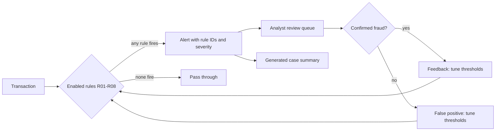

# Transaction Monitoring Rule Engine

A JSON-configured transaction monitoring engine: eight rules, 10,000 synthetic transactions, 24 UAT acceptance cases, per-rule precision and false-positive measurement, a measured threshold-tuning trade-off, and a comparison against an unsupervised Isolation Forest.

> **Synthetic data.** Every transaction in this repository is generated by `data/generate_data.py` with a fixed seed. No real customer data is used, no production system is touched, and the fraud patterns are hand-injected rather than observed.

> **Generated document.** Every figure below is produced by `analysis/build_readme.py` from the CSV/JSON artefacts in `reports/`. Editing this file by hand would put it out of step with the run.

## Headline results

| Metric | Baseline rules | Tuned rules |
|---|---|---|
| Rules evaluated | 8 | 8 |
| Alerts raised | 279 | 204 |
| Alert precision | 47.7% | 63.2% |
| False positives | 146 | 75 |
| FP rate (share of legitimate txns) | 1.489% | 0.765% |
| Fraud cases caught | 127/127 (100.0%) | 123/127 (96.9%) |
| Fraud transactions caught | 133/197 (67.5%) | 129/197 (65.5%) |

## Quick start

```powershell
python -m venv venv
.\venv\Scripts\Activate.ps1        # Windows PowerShell
# source venv/bin/activate          # macOS / Linux
pip install -r requirements.txt

python -m data.generate_data        # 10,000 rows, 197 fraud
python -m engine.validate_rules     # fail loudly on bad rule config
python -m pytest -q                 # 24 UAT cases
python -m tests.make_uat_report     # reports/uat_report.csv
python -m analysis.evaluate         # per-rule precision, FP rate, alerts.csv
python -m analysis.tune             # threshold sweep -> rules_tuned.json
python -m analysis.evaluate rules/rules_tuned.json
python -m analysis.iforest_compare  # rules vs Isolation Forest
python -m analysis.build_readme     # regenerate this file
python -m analysis.check_contract   # guard the headline figures
```

## Repository layout

```
data/generate_data.py          seeded synthetic dataset (10,000 txns, 127 fraud cases)
rules/rules.json               8 rules, all thresholds externalised
rules/rules_tuned.json         same rules after the tuning sweep
engine/rule_engine.py          rule implementations + windowing, no hard-coded thresholds
engine/validate_rules.py       schema validation for rule configs
tests/cases.py                 24 UAT cases: positive / negative / boundary per rule
tests/test_rules.py            pytest parametrisation (24 collected tests)
tests/make_uat_report.py       pass/fail CSV artefact
analysis/evaluate.py           hits, precision, false-positive rate, recall
analysis/tune.py               threshold sweep + chosen tuned config
analysis/iforest_compare.py    Isolation Forest comparison
analysis/build_readme.py       this document
analysis/check_contract.py     asserts the figures quoted outside the repo
reports/                       generated artefacts (CSV + JSON)
```

## Rules register

8 rules, all thresholds in JSON. Changing a threshold is a config change, not a code change, and requires no redeploy of the engine.

| ID | Rule | Condition | Severity | Rationale |
|---|---|---|---|---|
| R01 | High amount to new beneficiary | amount > 25,000 and is_new_beneficiary = 1 | High | Classic mule / authorised-push-payment setup: first payment to a fresh beneficiary at an unusual size. |
| R02 | Transaction velocity | more than 5 txns for one customer within 10 min | Medium | Account takeover: a compromised session fires several transfers in minutes, faster than a human types. |
| R03 | Odd-hour high amount | hour in [1, 5) and amount > 10,000 | Medium | Automated fraud tooling runs off-hours. Genuine customers do pay at night, which is the main source of false positives. |
| R04 | Failed attempts then success | >= 3 failed txns within 30 min, then a success | High | Card testing: repeated failures followed by one success suggests a working credential was found. |
| R05 | Structuring below reporting limit | 45,000 <= amount < 50,000 | High | Staying just under the reporting threshold to avoid a filing obligation. |
| R06 | Device change with high amount | device differs from customer's previous txn and amount > 20,000 | Medium | Device substitution plus a large debit is the strongest single signal of a hijacked session. |
| R07 | Location change within window | location differs from customer's previous txn within 30 min | High | Impossible travel: two locations inside a window the customer cannot physically cross. |
| R08 | Repeated transfers to same beneficiary | more than 3 txns to the same beneficiary within 60 min | Medium | Fan-out to a single beneficiary, typical of mule-account collection. |

## Boundary semantics

Threshold comparisons are strict (`>` not `>=`) and windows are trailing and inclusive of the boundary. This is a design decision, not an accident, because it gives every boundary case a defined answer that can be tested:

- `amount > 25,000` means exactly 25,000 does **not** fire (UAT-R01-03).
- A velocity window counts the current transaction, so `> 5 in 10 min` needs the 6th transaction to fire; exactly 5 does not (UAT-R02-03).
- The odd-hour band is half-open `[start, end)`, so 05:00 is already business hours, not night.
- The structuring band is `lower <= amount < upper`, so exactly 50,000 is outside the band (UAT-R05-03).
- Location change is inclusive at the boundary: exactly 30 minutes apart still fires (UAT-R07-03).

## Rule performance

Measured on the 10,000-row dataset with the baseline thresholds. `Precision` is true positives over rule hits; `FP rate` is false positives as a share of all legitimate transactions.

| ID | Rule | Hits | Precision | False pos | FP rate | Hits (tuned) | Precision (tuned) |
|---|---|---|---|---|---|---|---|
| R01 | High amount to new beneficiary | 65 | 38.5% | 40 | 0.408% | 23 | 100.0% |
| R02 | Transaction velocity | 4 | 100.0% | 0 | 0.000% | 4 | 100.0% |
| R03 | Odd-hour high amount | 85 | 29.4% | 60 | 0.612% | 74 | 33.8% |
| R04 | Failed attempts then success | 6 | 100.0% | 0 | 0.000% | 6 | 100.0% |
| R05 | Structuring below reporting limit | 45 | 66.7% | 15 | 0.153% | 45 | 66.7% |
| R06 | Device change with high amount | 56 | 44.6% | 31 | 0.316% | 34 | 67.6% |
| R07 | Location change within window | 12 | 100.0% | 0 | 0.000% | 12 | 100.0% |
| R08 | Repeated transfers to same beneficiary | 11 | 100.0% | 0 | 0.000% | 11 | 100.0% |

The weakest rules are the ones whose *legitimate* behaviour overlaps the fraud pattern, not the ones with the most hits. R03 is noisy because genuine night payments were deliberately seeded into the data; R01 and R06 are noisy because a first payment to a new beneficiary and a new phone are ordinary events (rent, tuition, a handset upgrade) as well as fraud signals.

Totals do not sum to 197 fraud transactions because rules overlap: R05 reports more true positives than the 25 rows injected for it, because a fraudulent 47,000 transfer on a changed device trips R05, R06 and R01 together. Counting each row once per rule is the point -- it shows which rule is doing the work.

## Tuning: what changed and what it cost

Each row is a full engine run with one threshold changed. `Cases lost` counts fraud cases that the baseline caught and this variant misses -- the cost side of the trade-off.

| Variant | Alerts | Precision | False pos | FP rate | Cases caught | Cases lost |
|---|---|---|---|---|---|---|
| baseline | 279 | 47.7% | 146 | 1.489% | 127 | 0 |
| R01 -> 30,000 | 256 | 52.0% | 123 | 1.255% | 127 | 0 |
| R01 -> 35,000 | 237 | 55.3% | 106 | 1.081% | 125 | 2 |
| R03 -> 12,000 | 268 | 49.6% | 135 | 1.377% | 127 | 0 |
| R03 -> 15,000 | 242 | 52.5% | 115 | 1.173% | 121 | 6 |
| R06 -> 25,000 | 257 | 51.0% | 126 | 1.285% | 125 | 2 |
| shipped: R01 35k, R06 25k, R03 12k | 204 | 63.2% | 75 | 0.765% | 123 | 4 |
| aggressive: R01 35k, R03 15k, R06 25k | 178 | 69.1% | 55 | 0.561% | 117 | 10 |

The shipped configuration is the **efficient** point: R01 to 35,000, R06 to 25,000 and R03 to 12,000. It removes 71 false positives, lifts precision from 47.7% to 63.2%, and costs 4 of 127 fraud cases (case recall 100.0% -> 96.9%). That works out at about 18 false positives removed per fraud case surrendered.

The last row is deliberately more aggressive: pushing R03 to 15,000 instead of 12,000 removes 20 additional false positives but loses 6 additional fraud cases -- roughly 3 false positives bought per case surrendered, around 5x worse than the shipped set. It is measured and reported, but not shipped: the last few points of precision are paid for in missed fraud.

The honest reading: raising a threshold does not remove fraud, it moves the cost. Every false positive avoided by lifting R01 also stops flagging the genuine large transfer that sits just under the new line. Case recall moves only slightly because of redundancy -- most fraud transactions already trip at least one other rule, so losing one signal rarely loses the case.

## Rules vs Isolation Forest

Same dataset, five features (`amount, hour, is_new_beneficiary, failed, txns_1h`), `contamination=0.02`. The rule engine is evaluated at baseline thresholds so the comparison is like-for-like.

| Measure | Rule engine | Isolation Forest |
|---|---|---|
| Alerts raised | 279 | 200 |
| Fraud transactions caught | 133/197 | 105/197 |
| Fraud cases caught | 127/127 (100.0%) | 83/127 (65.4%) |
| Alerts overlapping the other method | 136 | 136 |
| Unique alerts | 143 | 64 |
| Fraud caught only by this method | 51 | 23 |

Rules are explainable: an alert names the rule and the threshold it crossed, which is what a review process needs. The Isolation Forest flags the statistically unusual (200 alerts) but cannot say why, and 23 fraud transactions were caught only by the model against 51 caught only by the rules.

The caveat worth stating out loud: `contamination=0.02` was set to the true fraud rate, which is knowledge you would not have in production. `analysis/iforest_compare.py` therefore also reports the model at 5% and 10% contamination in `reports/iforest_summary.json`.

| Contamination | Alerts | Fraud txns | Cases caught |
|---|---|---|---|
| 2% | 200 | 105 | 83/127 (65.4%) |
| 5% | 500 | 149 | 109/127 (85.8%) |
| 10% | 1000 | 170 | 118/127 (92.9%) |

The practical read: rules for known patterns, the model as a second opinion for patterns nobody has written a rule for yet. Union of the two, ranked by severity, is the review queue.

## UAT summary

24 acceptance cases, 8 rules, three scenarios each (positive, negative, boundary). Result: **24 passed, 0 failed**. Full detail in `reports/uat_report.csv`.

| ID | Rule | Positive | Negative | Boundary | Verdict |
|---|---|---|---|---|---|
| R01 | High amount to new beneficiary | 1/1 | 1/1 | 1/1 | PASS |
| R02 | Transaction velocity | 1/1 | 1/1 | 1/1 | PASS |
| R03 | Odd-hour high amount | 1/1 | 1/1 | 1/1 | PASS |
| R04 | Failed attempts then success | 1/1 | 1/1 | 1/1 | PASS |
| R05 | Structuring below reporting limit | 1/1 | 1/1 | 1/1 | PASS |
| R06 | Device change with high amount | 1/1 | 1/1 | 1/1 | PASS |
| R07 | Location change within window | 1/1 | 1/1 | 1/1 | PASS |
| R08 | Repeated transfers to same beneficiary | 1/1 | 1/1 | 1/1 | PASS |

All 24 cases passed on the first run of the suite. No defects were found by the acceptance tests, and none are claimed here -- inventing a bug to look thorough would be worse than reporting a clean run.

Two real limitations were found by *reviewing* the design rather than by tests failing, and they are documented in the limitations section below: the structuring rule is a single-transaction approximation, and transaction-level recall understates detection for burst rules.

## Decision flow



## Limitations and known gaps

- **Synthetic data.** 10,000 generated transactions across 500 customers and 30 days, with 197 fraud rows in 127 injected cases (1.97% of rows). Real data has dirty timestamps, duplicate events, missing device and location fields, and far messier class imbalance.
- **Structuring is approximated.** The rule flags a single transaction inside the band below the reporting limit. Genuine structuring is *repeated* sub-threshold activity that only looks suspicious in aggregate. The simple version is kept because the boundary is testable and the limitation is explainable; a production version would need a per-customer aggregation window.
- **Transaction-level recall understates detection.** A velocity burst labels six rows fraud, but the rule fires once, on the sixth. That is why recall is reported per case as well as per row. The per-row figure is not a rule failure, it is a labelling artefact.
- **Rules only see the fields they are given.** There is no behavioural baseline per customer (usual amount range, usual hours, usual beneficiaries), so a rule cannot tell that 20,000 is ordinary for one customer and extreme for another.
- **Not real-time.** The engine evaluates a batch DataFrame. Streaming would need per-customer state stores for the velocity, repeat-beneficiary and failed-then-success windows.
- **No case management.** Alerts are a CSV. There is no queue, no analyst disposition, no feedback loop back into tuning. The Mermaid diagram shows where that would sit.

## Design decisions

The questions this project is meant to survive, answered with its own numbers.

- **Why JSON instead of hard-coded rules?** Thresholds change with fraud trends and analyst feedback, usually far more often than the code does. Keeping them in config means a tuning change is a reviewed file diff, `engine.validate_rules` catches typos that would otherwise silently produce zero alerts, and the engine can be exercised against several rule sets in one run -- which is exactly how `analysis/tune.py` measures the trade-off.
- **Why is 67.5% transaction recall not a failure?** Per case it is 100.0%. Burst rules alert on the triggering transaction, while the dataset labels every row in the burst as fraud. The measure an investigator cares about is whether the case was surfaced at all.
- **What did tuning actually trade?** 71 false positives removed, precision 47.7% -> 63.2%, case recall 100.0% -> 96.9%. Fewer alerts in the queue, at the price of no longer seeing the borderline cases. That is a business decision about analyst capacity, not a statistical one.
- **Why do boundary tests matter?** They pin down the comparison operators. `>` versus `>=` is the difference between 25,000 being suspicious or not, and without a test that decision silently flips the first time someone refactors a rule.
- **What breaks on real data?** Timezone-aware timestamps, duplicate events inflating velocity counts, missing device IDs making `shift()` comparisons meaningless, and volumes that need the O(n) window loops replaced with indexed lookups. The rule logic survives; the plumbing does not.
- **Why not just use the Isolation Forest?** Explainability and control. An alert that names the rule and the crossed threshold can be defended to a customer or a regulator; `anomaly score 0.61` cannot. The model is useful for finding patterns nobody has written a rule for yet.

## Reproducing the figures

Everything is seeded (`numpy.random.default_rng(42)` for the data, `random_state=42` for the model), so a clean checkout reproduces these exact numbers. `python -m analysis.check_contract` asserts the headline counts (10,000 rows, 197 fraud rows, 127 fraud cases, 8 rules, 24 UAT cases) and exits non-zero if any drift.
